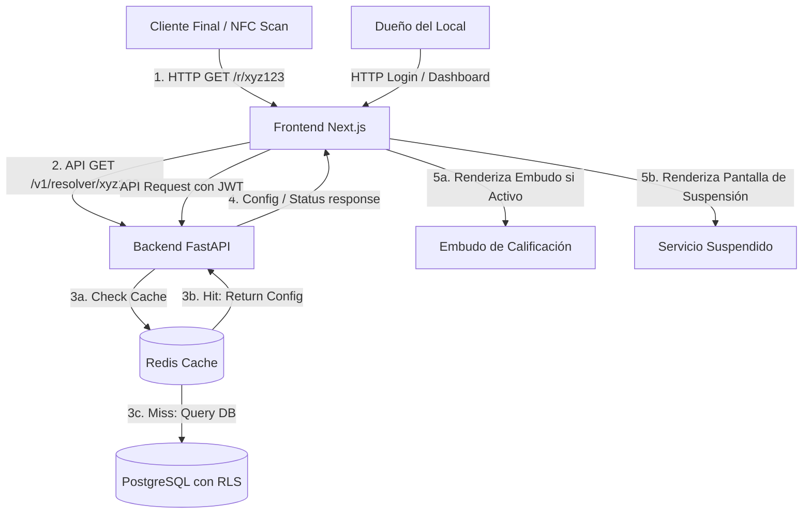
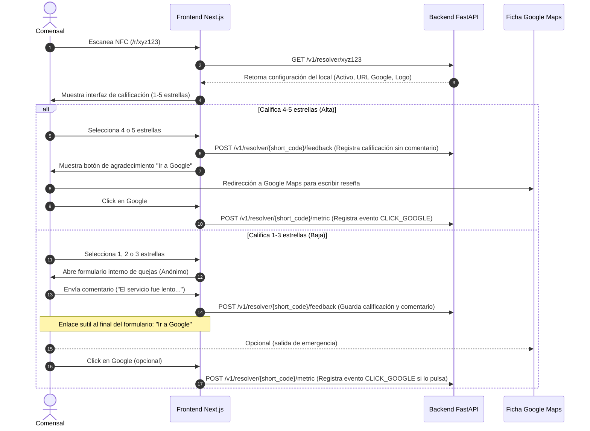

# Arquitectura del Sistema - QuickFeedback NFC

Este documento detalla las decisiones arquitectónicas, los flujos de datos y el modelo de datos diseñado para **QuickFeedback NFC**. Se enfoca en garantizar un aislamiento robusto, facilidad de despliegue, escalabilidad y una experiencia de usuario final óptima.

---

## 1. Patrón Arquitectónico General

El sistema sigue un patrón desacoplado de API REST Backend y una aplicación Frontend Single Page (SPA) con Renderizado del Lado del Servidor (SSR) selectivo.



*   **Backend (FastAPI):** Expone endpoints REST asíncronos y seguros. Se conecta a Redis para la resolución veloz de redirecciones y a PostgreSQL para persistencia de datos y reportería.
*   **Capa de Caché (Redis):** Almacena en memoria de forma temporal las configuraciones de locales resueltas a partir de su `short_code`, evitando consultas repetitivas a la base de datos y garantizando tiempos de respuesta mínimos (sub-2ms) ante ráfagas de escaneos.
*   **Frontend (Next.js):** Sirve tanto la interfaz pública y ultraligera para dispositivos móviles que escanean el NFC (corte estricto de optimización de velocidad) como el panel interactivo de administración.
*   **Base de Datos (PostgreSQL):** Un único motor relacional con políticas RLS (Row-Level Security) aplicadas a nivel de tablas.

---

## 2. Estrategia Multi-tenant: Aislamiento Lógico mediante Row-Level Security (RLS)

Para optimizar los costos del MVP y facilitar el mantenimiento de esquemas de bases de datos, se seleccionó un esquema compartido con aislamiento lógico estricto a nivel de base de datos usando **PostgreSQL RLS**.

### ¿Cómo funciona el RLS en nuestro sistema?
1.  Cada tenant (empresa/marca dueña de locales) tiene un identificador único global `tenant_id` (UUID).
2.  Las tablas críticas del negocio (`locations`, `reviews`, `nfc_cards`, `users`) contienen una columna `tenant_id`.
3.  Al autenticarse un administrador de local, su token JWT contiene su `tenant_id`.
4.  Cada conexión o query enviado por FastAPI establece una variable de sesión en la transacción de Postgres (ej. `SET LOCAL app.current_tenant_id = 'uuid-aqui'`).
5.  PostgreSQL filtra automáticamente todas las operaciones de lectura, escritura, actualización y borrado basándose en esa variable, previniendo que un administrador acceda a datos de otro tenant incluso si hay errores o vulnerabilidades en el código de FastAPI.

```sql
-- Ejemplo de política RLS
ALTER TABLE locations ENABLE ROW LEVEL SECURITY;

CREATE POLICY tenant_isolation_policy ON locations
    USING (tenant_id = NULLIF(current_setting('app.current_tenant_id', true), '')::uuid);
```

---

## 3. Mecanismo de Redirección Corta NFC (`/r/{short_code}`)

El enlace grabado en las tarjetas NFC físicas es inmutable una vez configurado. Por lo tanto, el sistema implementa una capa de redirección dinámica e inteligente.

### El Ciclo de Vida de un Escaneo:
1.  **Escaneo:** El usuario final escanea el tag NFC que contiene la URL `https://midominio.com/r/a7b8c9` (donde `a7b8c9` es un `short_code` único de base de datos).
2.  **Resolución en Frontend:** Next.js atrapa la ruta `/r/[code]` del lado del servidor (SSR) y hace una petición rápida al backend para validar el código.
3.  **Evaluación de Estado en Backend:**
    *   Si el `short_code` no existe o el tenant dueño de la tarjeta ha sido borrado lógicamente (`deleted_at IS NOT NULL`): Retorna `404 Not Found`.
    *   Si el tenant dueño de la tarjeta está inactivo (`is_active = false`, por ejemplo, por suspensión por impago): Retorna un objeto con estado `SUSPENDED`.
    *   Si está activo y no eliminado: Retorna la URL de Google Maps del local, su nombre, logotipo y colores personalizados de branding.
4.  **Decisión en Frontend (UI):**
    *   Si el estado es `SUSPENDED`: El frontend renderiza inmediatamente una pantalla limpia con un mensaje de servicio inactivo.
    *   Si el estado es `ACTIVE`: Carga la interfaz dinámica del embudo de calificación.

---

## 4. Flujo de Datos del Embudo de Calificación (Gating Compliant)

El embudo UX cumple de forma estricta las normativas de Google. A continuación se muestra cómo fluyen los datos y las decisiones según el input del cliente:



---

## 5. Arquitectura de Servicios del Backend (FastAPI)

El backend está organizado para permitir escalabilidad horizontal y facilitar pruebas automatizadas:

*   **Capa de Controladores (API Routers):** Recibe las solicitudes HTTP, valida los payloads de entrada usando schemas de Pydantic y delega a la capa de servicios.
*   **Capa de Servicios (Business Logic):** Implementa las reglas del negocio (cálculo de métricas, validación de códigos de redirección, verificación de estado de cuenta).
*   **Capa de Acceso a Datos (SQLAlchemy Repositories):** Realiza las operaciones en la base de datos usando sesiones asíncronas y gestiona la inyección de la variable de tenant para RLS.
*   **Gestor de Caché (Redis In-Memory Key-Value):** Resuelve las lecturas de los códigos NFC en tiempo récord. Al recibir un `short_code`, el servicio de resolución consulta a Redis. Si el valor existe (Cache Hit), se retorna instantáneamente la configuración del local. Si no existe (Cache Miss), se lee de PostgreSQL y se escribe en Redis con un tiempo de expiración (TTL). La caché se invalida inmediatamente si un administrador actualiza su local o si el súper administrador suspende la cuenta del tenant.
*   **Gestor de Tareas de Fondo (Background Tasks):** Para el envío de notificaciones por email al administrador cuando se reciba una queja crítica (1-3 estrellas) sin ralentizar la respuesta HTTP del cliente final.
