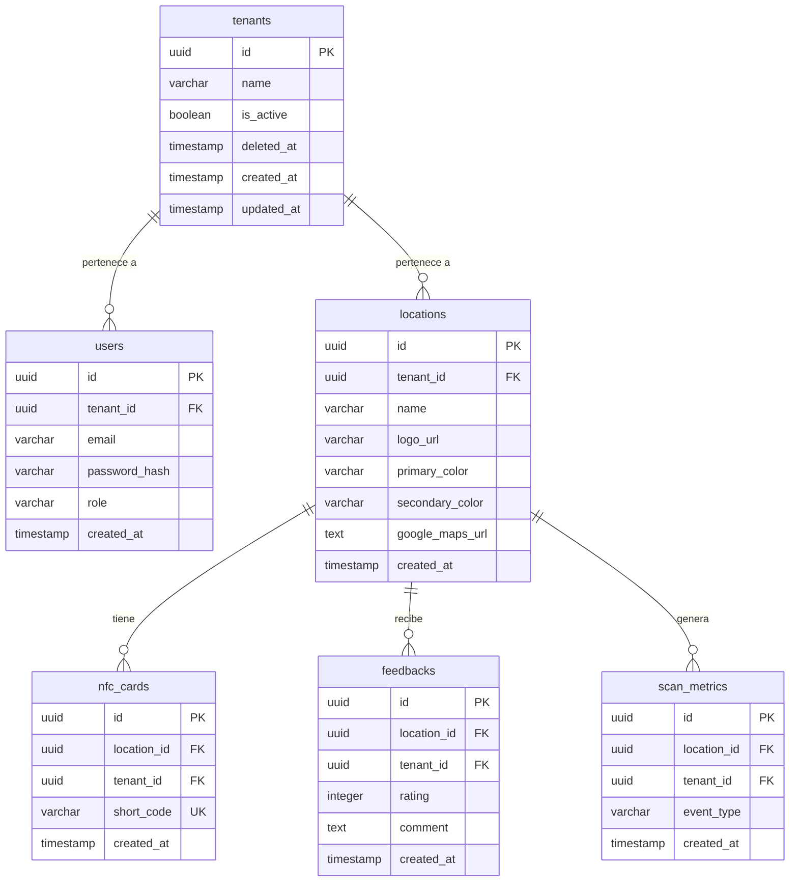

# Esquema de Base de Datos - QuickFeedback NFC

Este documento define la estructura de tablas de la base de datos PostgreSQL, los índices necesarios para el rendimiento, y el mecanismo de configuración de **Row-Level Security (RLS)** para el aislamiento lógico multi-tenant.

---

## 1. Diagrama de Relaciones (ERD)



---

## 2. Sentencias DDL (Definición de Tablas)

```sql
-- Habilitar extensión UUID
CREATE EXTENSION IF NOT EXISTS "uuid-ossp";

-- 1. Tabla de Inquilinos (Tenants con Soft Delete)
CREATE TABLE tenants (
    id UUID PRIMARY KEY DEFAULT uuid_generate_v4(),
    name VARCHAR(255) NOT NULL,
    is_active BOOLEAN NOT NULL DEFAULT TRUE,
    deleted_at TIMESTAMP WITH TIME ZONE, -- Soft delete
    created_at TIMESTAMP WITH TIME ZONE DEFAULT CURRENT_TIMESTAMP,
    updated_at TIMESTAMP WITH TIME ZONE DEFAULT CURRENT_TIMESTAMP
);

-- 2. Tabla de Usuarios Administradores (ON DELETE RESTRICT para proteger datos históricos B2B)
CREATE TABLE users (
    id UUID PRIMARY KEY DEFAULT uuid_generate_v4(),
    tenant_id UUID NOT NULL REFERENCES tenants(id) ON DELETE RESTRICT,
    email VARCHAR(255) NOT NULL UNIQUE,
    password_hash VARCHAR(255) NOT NULL,
    role VARCHAR(50) NOT NULL DEFAULT 'admin', -- 'admin', 'superadmin'
    created_at TIMESTAMP WITH TIME ZONE DEFAULT CURRENT_TIMESTAMP,
    updated_at TIMESTAMP WITH TIME ZONE DEFAULT CURRENT_TIMESTAMP
);

-- 3. Tabla de Locales
CREATE TABLE locations (
    id UUID PRIMARY KEY DEFAULT uuid_generate_v4(),
    tenant_id UUID NOT NULL REFERENCES tenants(id) ON DELETE RESTRICT,
    name VARCHAR(255) NOT NULL,
    logo_url VARCHAR(512),
    primary_color VARCHAR(7) DEFAULT '#000000',
    secondary_color VARCHAR(7) DEFAULT '#FFFFFF',
    google_maps_url TEXT NOT NULL,
    created_at TIMESTAMP WITH TIME ZONE DEFAULT CURRENT_TIMESTAMP,
    updated_at TIMESTAMP WITH TIME ZONE DEFAULT CURRENT_TIMESTAMP
);

-- 4. Tabla de Tarjetas/Códigos NFC
CREATE TABLE nfc_cards (
    id UUID PRIMARY KEY DEFAULT uuid_generate_v4(),
    location_id UUID NOT NULL REFERENCES locations(id) ON DELETE RESTRICT,
    tenant_id UUID NOT NULL REFERENCES tenants(id) ON DELETE RESTRICT,
    short_code VARCHAR(20) NOT NULL UNIQUE,
    created_at TIMESTAMP WITH TIME ZONE DEFAULT CURRENT_TIMESTAMP
);

-- 5. Tabla de Feedback Interno (Anónimo y Simplificado)
CREATE TABLE feedbacks (
    id UUID PRIMARY KEY DEFAULT uuid_generate_v4(),
    location_id UUID NOT NULL REFERENCES locations(id) ON DELETE RESTRICT,
    tenant_id UUID NOT NULL REFERENCES tenants(id) ON DELETE RESTRICT,
    rating INT NOT NULL CHECK (rating BETWEEN 1 AND 3),
    comment TEXT NOT NULL CHECK (char_length(comment) >= 10),
    created_at TIMESTAMP WITH TIME ZONE DEFAULT CURRENT_TIMESTAMP
);

-- 6. Tabla de Métricas de Escaneo
CREATE TABLE scan_metrics (
    id UUID PRIMARY KEY DEFAULT uuid_generate_v4(),
    location_id UUID NOT NULL REFERENCES locations(id) ON DELETE RESTRICT,
    tenant_id UUID NOT NULL REFERENCES tenants(id) ON DELETE RESTRICT,
    event_type VARCHAR(50) NOT NULL CHECK (event_type IN ('SCAN', 'CLICK_GOOGLE')),
    created_at TIMESTAMP WITH TIME ZONE DEFAULT CURRENT_TIMESTAMP
);
```

---

## 3. Optimización de Índices

Para garantizar que el backend pueda resolver la redirección en milisegundos cuando un cliente escanea el código NFC, se implementan los siguientes índices críticos:

```sql
-- B-Tree único para la resolución directa de URLs de redirección (Máxima prioridad)
CREATE UNIQUE INDEX idx_nfc_cards_short_code ON nfc_cards(short_code);

-- Índices de Llave Foránea para joins y RLS veloces
CREATE INDEX idx_users_tenant_id ON users(tenant_id);
CREATE INDEX idx_locations_tenant_id ON locations(tenant_id);
CREATE INDEX idx_nfc_cards_tenant_id ON nfc_cards(tenant_id);
CREATE INDEX idx_feedbacks_tenant_id ON feedbacks(tenant_id);
CREATE INDEX idx_scan_metrics_tenant_id ON scan_metrics(tenant_id);

-- Índice compuesto para reportería y analíticas semanales
CREATE INDEX idx_scan_metrics_location_event ON scan_metrics(location_id, event_type, created_at);
```

---

## 4. Configuración de Row-Level Security (RLS)

A excepción de la tabla `tenants` (cuya lectura global es requerida por el backend para evaluar la activación durante el ruteo corto), todas las tablas relacionadas con el negocio tienen RLS activo.

Las políticas están diseñadas para permitir:
1.  **Lecturas Públicas (SELECT):** Acceso público anónimo a la información de branding de `locations` y `nfc_cards` para la resolución de códigos NFC.
2.  **Escrituras Públicas (INSERT):** Acceso público anónimo a `feedbacks` y `scan_metrics` para que los comensales registren sus opiniones y métricas.
3.  **Aislamiento Restringido:** Las operaciones administrativas (y consultas privadas de quejas) se limitan al `tenant_id` del usuario autenticado.
4.  **Acceso de Súper Administrador:** Los súper administradores (`app.current_user_role = 'superadmin'`) pueden saltarse las restricciones de tenant y operar de forma global.

### Script SQL para Habilitación de RLS:

```sql
-- Habilitar RLS en las tablas
ALTER TABLE users ENABLE ROW LEVEL SECURITY;
ALTER TABLE locations ENABLE ROW LEVEL SECURITY;
ALTER TABLE nfc_cards ENABLE ROW LEVEL SECURITY;
ALTER TABLE feedbacks ENABLE ROW LEVEL SECURITY;
ALTER TABLE scan_metrics ENABLE ROW LEVEL SECURITY;

-- 1. Políticas para Usuarios Administradores
CREATE POLICY users_tenant_policy ON users
    FOR ALL USING (
        current_setting('app.current_user_role', true) = 'superadmin'
        OR tenant_id = NULLIF(current_setting('app.current_tenant_id', true), '')::uuid
    );

-- 2. Políticas para Locales
CREATE POLICY locations_select_policy ON locations
    FOR SELECT USING (true); -- SELECT público para resolución de short_code

CREATE POLICY locations_admin_policy ON locations
    FOR ALL 
    USING (
        current_setting('app.current_user_role', true) = 'superadmin'
        OR tenant_id = NULLIF(current_setting('app.current_tenant_id', true), '')::uuid
    );

-- 3. Políticas para Tarjetas NFC
CREATE POLICY nfc_cards_select_policy ON nfc_cards
    FOR SELECT USING (true); -- SELECT público para resolución de short_code

CREATE POLICY nfc_cards_admin_policy ON nfc_cards
    FOR ALL 
    USING (
        current_setting('app.current_user_role', true) = 'superadmin'
        OR tenant_id = NULLIF(current_setting('app.current_tenant_id', true), '')::uuid
    );

-- 4. Políticas para Feedback Interno
CREATE POLICY feedbacks_insert_policy ON feedbacks
    FOR INSERT WITH CHECK (true); -- comensales anónimos pueden enviar quejas

CREATE POLICY feedbacks_admin_policy ON feedbacks
    FOR ALL 
    USING (
        current_setting('app.current_user_role', true) = 'superadmin'
        OR tenant_id = NULLIF(current_setting('app.current_tenant_id', true), '')::uuid
    );

-- 5. Políticas para Métricas de Escaneo
CREATE POLICY scan_metrics_insert_policy ON scan_metrics
    FOR INSERT WITH CHECK (true); -- comensales anónimos registran escaneos/clicks

CREATE POLICY scan_metrics_admin_policy ON scan_metrics
    FOR ALL 
    USING (
        current_setting('app.current_user_role', true) = 'superadmin'
        OR tenant_id = NULLIF(current_setting('app.current_tenant_id', true), '')::uuid
    );
```

---

## 5. Implementación e Inyección de Variables en el Backend

Cuando un usuario realiza una llamada, FastAPI intercepta la petición, valida su token JWT y extrae el `tenant_id` y el `role`.

Antes de ejecutar cualquier consulta, la dependencia de sesión de base de datos establece las variables de sesión locales de Postgres para la transacción actual:

```python
# Ejemplo conceptual en FastAPI utilizando SQLAlchemy asíncrono
async def get_db_session(tenant_id: UUID = None, role: str = None):
    async with async_session_maker() as session:
        # Setea el rol del usuario (ej. 'admin', 'superadmin' o vacío para anónimos)
        if role:
            await session.execute(
                text("SET LOCAL app.current_user_role = :role"),
                {"role": role}
            )
        # Setea el tenant_id en la variable de sesión para RLS (solo si no es superadmin)
        if tenant_id and role != "superadmin":
            await session.execute(
                text("SET LOCAL app.current_tenant_id = :tenant_id"),
                {"tenant_id": str(tenant_id)}
            )
        yield session
```
*(Nota: El comando `SET LOCAL` asegura que las variables de configuración `app.current_tenant_id` y `app.current_user_role` persistan únicamente durante la transacción actual, protegiendo las conexiones reutilizadas en el pool de base de datos).*
